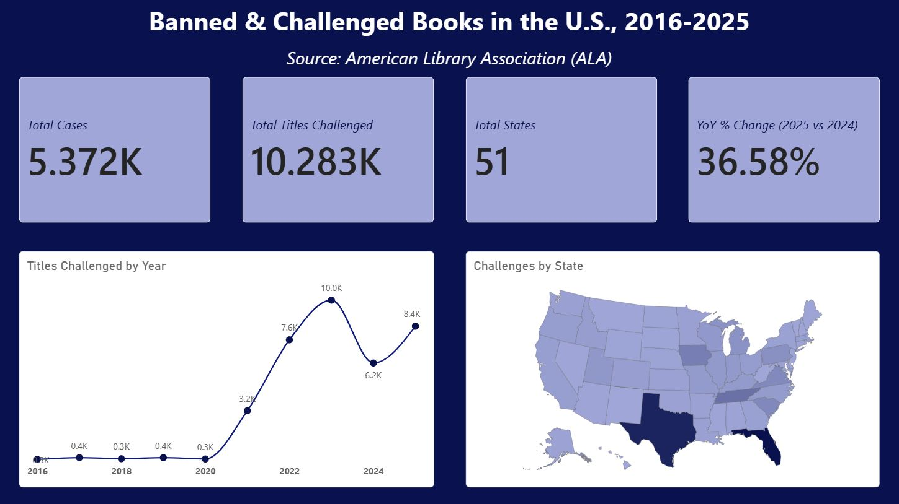
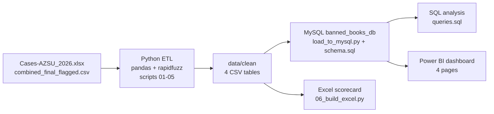
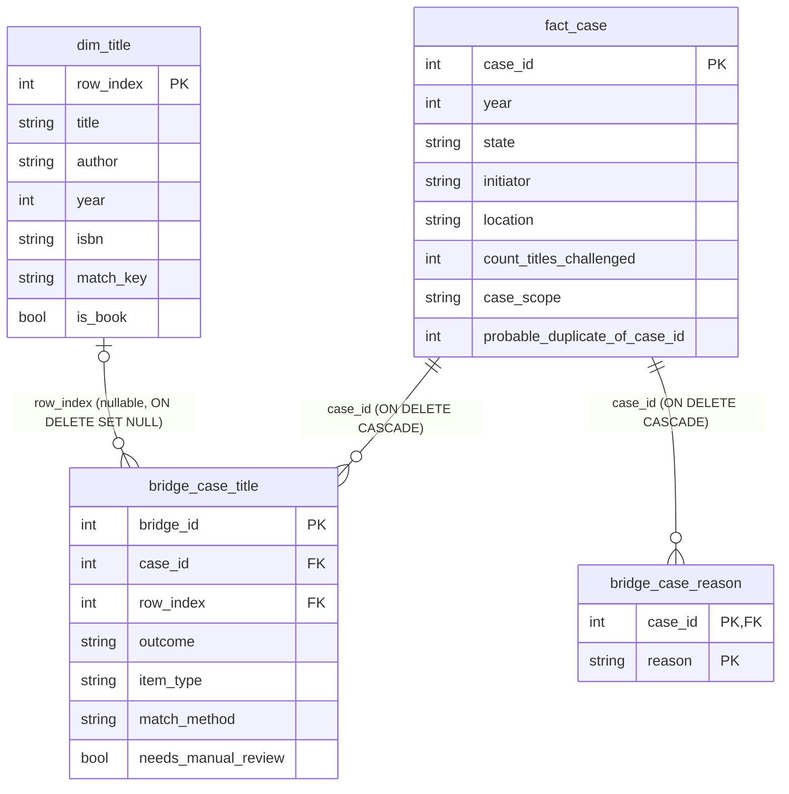
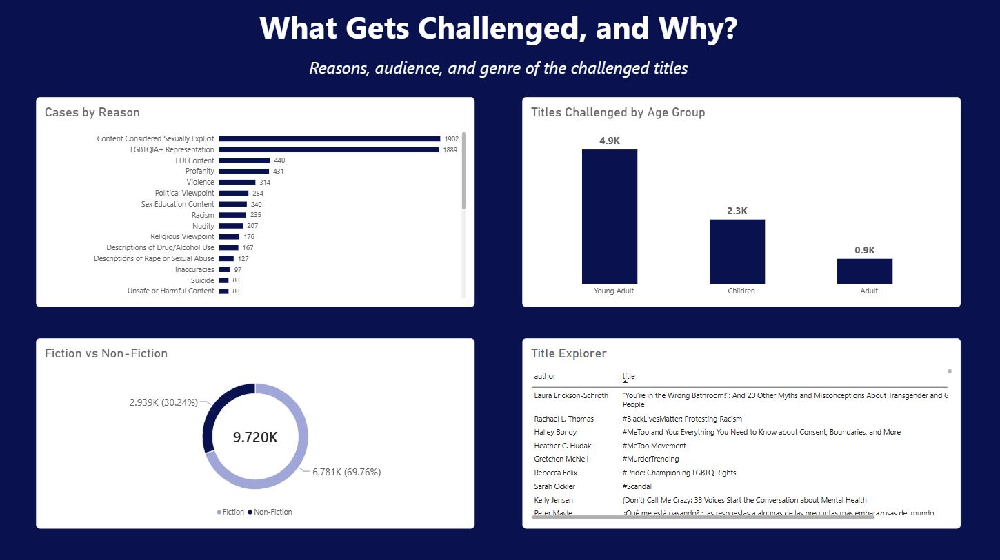
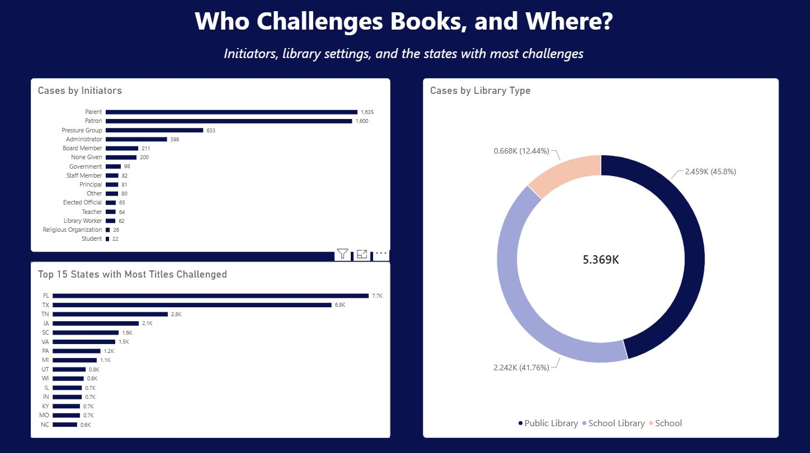
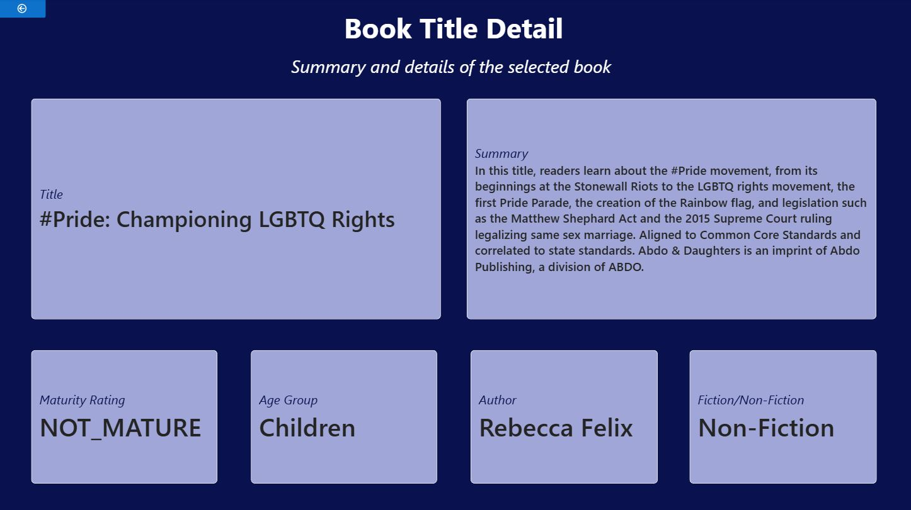

# Book Challenges in the U.S., 2016-2025

An end-to-end analysis of 5,372 library and school book challenge cases reported to the American Library Association (ALA): Python ETL, a MySQL star schema, SQL analysis, a Power BI dashboard and an Excel state scorecard.

**Headline findings**

1. Title challenges rose from 260 in 2016 to a peak of 10,032 in 2023. Part of the 2021 jump is probably a data-collection effect (see [Limitations](#7-limitations)).
2. Sexually explicit content and LGBTQIA+ representation are the two most common reasons (as reported by those who challenge), far ahead of the rest.
3. Florida and Texas have the most title challenges, but a few large list challenges drive those totals.



---

## 1. Table of contents

[Problem](#2-problem-statement) | [Data sources](#3-data-sources) | [Architecture](#4-architecture) | [Data-quality decisions](#5-data-quality-decisions) | [Key findings](#6-key-findings) | [Limitations](#7-limitations) | [Reproduce](#8-how-to-reproduce) | [Repo structure](#9-repo-structure-tech-stack-and-docs)

## 2. Problem statement

Every year, the American Library Association (ALA) collects reports of attempts to remove or restrict books in libraries and schools across the United States. These reports offer a way to examine who challenges books, where challenges happen, and what motivates them.

I used the dataset to explore four questions:


- **Who is challenging books?**
- **Where are challenges happening?** By state and setting, including public libraries, school libraries, and schools.
- **Why are books being challenged?** Based on the reasons provided in the reports.
- **What happens to the challenged books?**

## 3. Data sources

| Source | What it provides | Files |
|---|---|---|
| American Library Association (ALA) challenge data, Cases table | One row per challenge case: year, state, setting, initiator, reasons, outcome counts, and the list of titles challenged | `data/raw/Cases-AZSU_2026.xlsx` |
| ALA challenge data, Titles table | One row per title. A cleaned version of it, enriched with Google Books, is the title dimension | `data/raw/combined_final_flagged.csv` |
| Google Books API | Title details added to the ALA titles: page count, language, maturity rating, summary | columns of `combined_final_flagged.csv` |

- The MIT license covers the code only. The data remains subject to its owners' terms.
- **The Google Books `summary` text is not published.** Every `summary` value in `data/raw/combined_final_flagged.csv` and `data/clean/dim_title.csv` is replaced with the existing placeholder `NOT_FOUND`. Nothing else in those files, and no script or schema, was changed, and the scripts produce the same tables (see [How to reproduce](#8-how-to-reproduce)). The Title Detail dashboard screenshot and the dashboard PDF still show the summary of one book.
- 303 of 10,380 titles had no Google Books match (`NOT_FOUND`). 8,186 matched by ISBN and 1,891 by a title-and-author fuzzy match.

## 4. Architecture



The same four tables are used in the CSVs, MySQL and Power BI. The Excel workbook uses `fact_case` and `bridge_case_reason` only.



- A case can challenge many books and a book can be challenged in many cases, so they connect through `bridge_case_title`. Reasons work the same way through `bridge_case_reason`.
- I join on `row_index`, never on ISBN (leading zeros were lost and some cells hold several ISBNs).
- `bridge_case_title.candidate_row_index` and `fact_case.probable_duplicate_of_case_id` are deliberately not foreign keys.
- The view `fact_case_deduped` hides case 4564, a probable duplicate. Queries, the dashboard and the workbook use the remaining 5,372 cases.
- Row counts: `dim_title` 10,380, `fact_case` 5,373, `bridge_case_title` 41,381, `bridge_case_reason` 7,050.

## 5. Data-quality decisions

| Issue | What I did | Why |
|---|---|---|
| 4 corrupted rows in the cases file. Excel's Text to Columns on a giant title list overwrote year, state and counts with title fragments | Rebuilt each title list. Recovered location, initiator and reasons only where they matched a known value, blanked the rest and flagged the rows | I can't tell which column each number belonged to, so the numbers can't be recovered |
| Years missing for the 4 corrupted cases | Inferred from the Titles file (3939 to 2023, 4564 to 2023, 4588 to 2021, 4781 to 2023). A year is accepted only if it holds at least 80% of the leftover yearly count. Recorded in `year_source`. State stays unknown | I kept the 4 large cases and flagged the inferred years |
| 722 unnamed columns in the cases file (754 columns, 32 named) | Dropped them | Nearly all stray values in them (1,712 of 1,727) come from the 4 corrupted rows |
| Case 4564 shares 676 of 694 books with case 3939 | Marked `probable_duplicate_of_case_id = 3939` and excluded it through `fact_case_deduped`. No row was deleted | It was counted twice (738 bridge rows). Whether it is truly a duplicate is a judgment call |
| Cases list titles in one text field | Split with Python's `csv` module instead of on commas, then matched to `dim_title`: exact, exact on first author, then fuzzy at a score of 90 or more | Titles like "10,000 Dresses" contain commas, and ALA lists only the first author |
| 774 of 41,381 title rows have no `row_index`: 527 non-books (films, music, displays and similar), 186 corrupted fragments, 31 unmatched, 30 weak fuzzy matches | Labeled `non_book`, `corrupted_fragment` and `unmatched`. The 30 weak fuzzy matches (score 60 to 78, under the cutoff of 90) keep their best guess in `candidate_row_index` but are not linked. The 61 rows flagged for manual review are the 31 unmatched plus these 30 | A wrong link is worse than no link. Nothing was deleted, so analysis can filter on `item_type` |
| `average_rating` | Dropped | 88% missing |
| Per-year counts and `total_cases` in the Titles file | Not stored in `dim_title`. Counts are derived in SQL from the bridge | `total_cases` is larger than the sum of its yearly columns for 1,326 titles, cause unknown |
| `dim_title.year` has 15 invalid values (for example 202, 20224, 2003202) | Loaded as-is | Fixing them would be guessing. Filter them out before analyzing publication years |
| State `INT` (international) and blank state | Kept in the data, left out of the maps, the 51-state count and the state charts | They can't be placed on a U.S. map |

## 6. Key findings

**Title challenges** is the sum of `count_titles_challenged` (37,084 in total). **Cases** is the number of cases (5,372). One district-wide challenge can add hundreds of title challenges and only one case.

### How the counts relate

| Pair of numbers | Why they differ |
|---|---|
| 5,373 cases in `fact_case`, 5,372 used | Case 4564, a probable duplicate of case 3939 (738 title rows), is excluded through `fact_case_deduped`. |
| 37,084 title challenges, 41,381 rows in `bridge_case_title` | 37,084 is the sum of the counts the cases report. The 41,381 rows are the titles actually listed:<br>- 37,274 rows in the 5,366 cases with a count<br>- 3,369 rows in 6 cases with a blank count (the corrupted cases 3939, 4588 and 4781, plus cases 419, 1036 and 1567)<br>- 738 rows in case 4564<br>In 5,193 of the 5,366 cases the rows equal the reported count. In the other 173 the list is longer (190 rows in all, 37,274 - 190 = 37,084). The cause of those 190 is not established. |
| 10,387 titles in the ALA Titles file, 10,380 in `dim_title`, 10,282 distinct titles in the bridge, 10,276 without case 4564 | The Titles file has 10,387 data rows (10,388 sheet rows with the header). 7 of its titles are not in `combined_final_flagged.csv`; I deliberately did not backfill them (listed in [docs/phase1_etl.md](docs/phase1_etl.md)). 98 titles in `dim_title` are never linked from a case row: 86 of them have yearly counts above 0 in the Titles file and 12 have none. 6 titles appear only in case 4564. 10,380 - 98 = 10,282. |

**Dashboard card note.** The card "Total Titles Challenged" shows 10,283. The data contains 10,282 distinct titles (the same number from `COUNT(DISTINCT row_index)` in MySQL and from the CSV). `DISTINCTCOUNT` counts a blank as a value (`DISTINCTCOUNTNOBLANK` does not), and the 774 title rows with no `row_index` add one, so 10,282 + 1 = 10,283.

### Overview

Title challenges by year: 260 (2016), 372, 305, 371, 288 (2020), 3,249 (2021), 7,598 (2022), 10,032 (2023), 6,175 (2024), 8,434 (2025, +36.58% on 2024). The most challenged titles are *Gender Queer: A Memoir* (464 challenges), *All Boys Aren't Blue: A Memoir-Manifesto* (308) and *The Bluest Eye* (246). Ellen Hopkins (1,350) and Sarah J. Maas (1,164) are the most challenged authors.


### Reasons and content

Cases by reason: sexually explicit content 1,902, LGBTQIA+ representation 1,889, EDI content 440, profanity 431, violence 314.

The bridge links 10,282 distinct titles. 9,720 of them have a fiction or non-fiction value (562 do not): 6,781 are fiction and 2,939 non-fiction, so 69.8% are fiction. By audience, 4,884 titles are Young Adult, 2,339 Children and 910 Adult (2,149 have no age group). The dashboard shows these as 4.9K, 2.3K and 0.9K. The counts include titles that appear only in case 4564; without that case they are 6,778 / 2,936 and 4,882 / 2,336 / 909.



### Who and where

Parents (1,635 cases) and patrons (1,600) start the most cases, 3,235 of 5,372 (60.2%) together. Pressure groups (633) and administrators (398) follow. By setting, 2,459 cases are in public libraries, 2,242 in school libraries and 668 in schools. By state, Florida (7,656 title challenges), Texas (6,755), Tennessee (2,788) and Iowa (2,085) lead.

Cases that rated titles from the Booklooks, RatedBooks or TakeBackTheClassroom target lists (3,158 cases) average 10.9 titles and a 40.1% removal rate. The other 2,208 cases average 1.3 titles and 17.6%.

Of the 41,381 title rows, 20,684 (50.0%) have an unknown outcome. Withdrawn or removed is the largest known group (14,218 rows, 34.4% of all rows), followed by retained (2,405, 5.8%), restricted (2,377) and relocated (1,231). Patrons have the highest retained share (28.1% of rows, 72.8% of rows with a known outcome). Initiators with mostly unknown outcomes, such as elected officials, should be read with care.



### Title detail (drill-through)

Right-click a title in the Title Explorer table to open a page with its author, maturity rating, age group and fiction or non-fiction label. 17 titles are rated MATURE but shelved for children, led by *It's Perfectly Normal* (128 challenges).



The full dashboard export is in [`powerbi/dashboard.pdf`](powerbi/dashboard.pdf).

### Excel state scorecard

[`excel/state_scorecard.xlsx`](excel/state_scorecard.xlsx) has a state by year heatmap, a PivotTable with slicers, a scorecard with one row per state (cases, title challenges, top reason, top initiator) and a Notes sheet with 15 live checks, all passing. Top of the scorecard:

| State | Cases | Title challenges | Top reason | Top initiator |
|---|---|---|---|---|
| FL | 285 | 7,656 | Content Considered Sexually Explicit | Parent |
| TX | 408 | 6,755 | LGBTQIA+ Representation | Parent |
| TN | 115 | 2,788 | Content Considered Sexually Explicit | Parent |
| IA | 142 | 2,085 | Content Considered Sexually Explicit | Government |
| SC | 147 | 1,597 | LGBTQIA+ Representation | Parent |

Texas has more cases than Florida but fewer title challenges, so the two metrics rank states differently.

More detail: [SQL queries and results](docs/phase2_sql.md), [dashboard design](docs/phase3_powerbi.md), [workbook formulas](docs/phase4_excel.md). All query outputs are in [`sql_results/`](sql_results/).

## 7. Limitations

- **Self-reported.** Challenges and reasons are reported to the ALA, and the reasons are assigned by the reporter. They are not verified.
- **Imperfect title matching.** 98.1% of title rows matched a book exactly (title and author, first author only, or title only), 1,355 of them on first author only. 39 were fuzzy (9 accepted, 30 not). The 774 rows with no link (1.9%, breakdown in Section 5) are left out of title-based results. All 61 manual-review rows are inside the 774. Nine of them belong to 7 titles that are in the ALA Titles file but missing from `combined_final_flagged.csv`, so they had no book record to link to.
- **About half of outcomes are unknown** (20,684 of 41,381 title rows), so outcome rates depend heavily on how those rows are treated.
- **The 2021 jump is probably partly a data-collection effect.** Title challenges rose 1,028% from 2020 to 2021. I would not read all of it as more challenges.
- **State totals are driven by a few district-wide list challenges.** In Florida, 18 cases with 100 or more titles each make up 5,255 of 7,656 title challenges. In Texas, 14 such cases make up 4,511 of 6,755.
- **Corrupted records.** The 4 corrupted cases have inferred years and no state (3 remain after deduplication). Case 4564 is a probable duplicate that I excluded instead of deleting. `INT` (23 title challenges, all in 2025) and blank states are left out of the maps.
- **`dim_title.year` has 15 invalid values.**
- **Not built or not published.** The dashboard has no Data Quality page, slicers or Title Detail sparkline. The `.pbix` is not published because it embeds all of the data.

## 8. How to reproduce

The cleaned tables are already in `data/clean/`, so step 3 alone gives you the database. You need Python (tested on Windows with 3.10), and MySQL 8.x for step 3. On Windows, set UTF-8 first (see step 2), because the ETL scripts print accented titles.

```bash
# 1. Get the code and install the libraries
git clone https://github.com/mschinmayi07/ala-book-challenges-analytics.git
cd ala-book-challenges-analytics
pip install -r requirements.txt
```

```bash
# 2. Rebuild the clean tables from the raw files (run from the repo root, in this order)
# Windows PowerShell: $env:PYTHONUTF8="1"    
python scripts/01_clean_cases.py
python scripts/02_build_fact_and_reasons.py
python scripts/03_build_dim_title_and_bridge.py
python scripts/04_infer_corrupted_years.py
python scripts/05_reconcile.py
```

Script 01 creates the staging file `data/clean/cases_clean_full.csv`. Scripts 01 to 04 overwrite the files in `data/clean/`; script 05 only prints a report.

```bash
# 3. Load MySQL (the script creates banned_books_db and runs sql/schema.sql)
export MYSQL_USER=your_mysql_user         
export MYSQL_PASSWORD=your_password       
python scripts/load_to_mysql.py
```

```text
# 4. Run the analysis
Open sql/queries.sql in MySQL Workbench with banned_books_db selected and run the queries one at a time.
sql/row_count.sql re-checks the table counts.
```

- **Data:** raw inputs are in `data/raw/`, clean tables in `data/clean/`, query exports in `sql_results/`.
- **Power BI:** the `.pbix` is not in the repo. Connect Power BI Desktop to `banned_books_db` and follow [docs/phase3_powerbi.md](docs/phase3_powerbi.md). `dim_title.summary` is `NOT_FOUND` in the published data.
- **Excel:** `excel/state_scorecard.xlsx` is included. 

**Tested.** On Windows with Python 3.10 and MySQL 8.0.46, using a copy of this repo and an empty, separate MySQL server:

- Scripts 01 to 05, end to end. The four committed clean CSVs came out byte for byte identical.
- `scripts/load_to_mysql.py` and `sql/schema.sql`, run twice. Row counts matched the CSVs both times (10,380 / 5,373 / 41,381 / 7,050).
- All 13 queries in `sql/queries.sql` and `sql/row_count.sql`. Every result is identical to its file in `sql_results/`, in the same row order.


## 9. Repo structure, tech stack and docs

```text
.
├── README.md
├── LICENSE                  MIT, code only
├── requirements.txt
├── .gitignore
├── data/
│   ├── raw/                 Cases-AZSU_2026.xlsx, combined_final_flagged.csv (summary replaced)
│   └── clean/               fact_case, dim_title (summary replaced), bridge_case_title, bridge_case_reason
├── scripts/                 01-05 ETL and checks, config.py, load_to_mysql.py
├── sql/                     schema.sql, queries.sql, row_count.sql, CHANGELOG.md
├── sql_results/             CSV export of every query, row_counts.png
├── excel/                   state_scorecard.xlsx
├── powerbi/                 dashboard.pdf
├── images/                  the four dashboard screenshots
└── docs/                    phase1_etl.md, phase2_sql.md, phase3_powerbi.md, phase4_excel.md
```

**Tech stack:** Python (pandas, rapidfuzz, openpyxl, pymysql), MySQL 8, SQL (CTEs, window functions), Power BI Desktop with DAX, Excel (SUMIFS, COUNTIFS, INDEX/MATCH, a PivotTable with slicers).

**Docs.** The 3 phase documents hold the full detail, including the checks:

- [docs/phase1_etl.md](docs/phase1_etl.md): cleaning, matching, issues and fixes
- [docs/phase2_sql.md](docs/phase2_sql.md): schema, loader, queries
- [docs/phase3_powerbi.md](docs/phase3_powerbi.md): data model, DAX, pages
